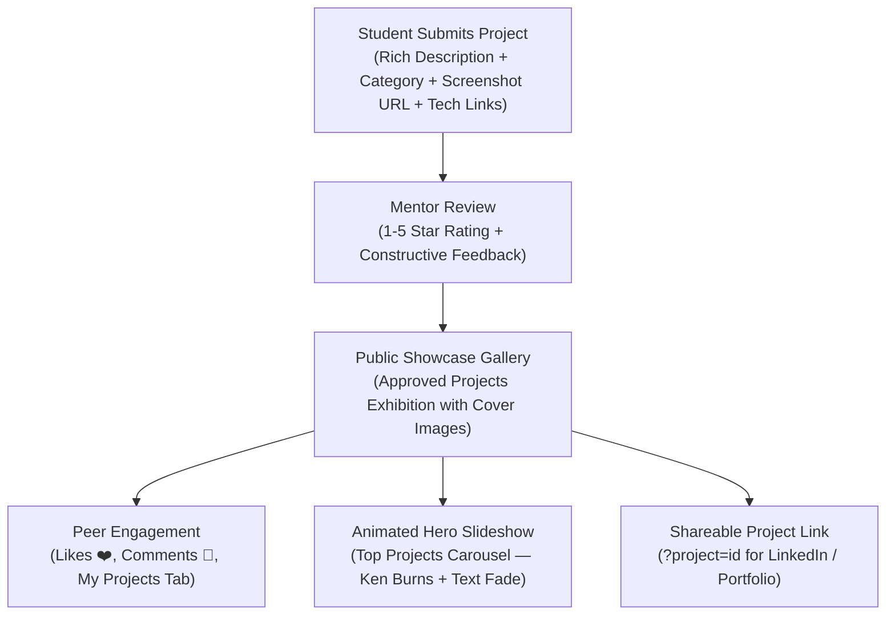
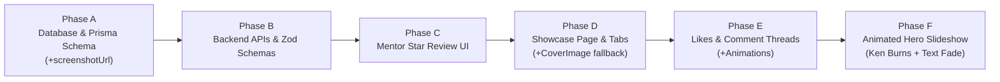
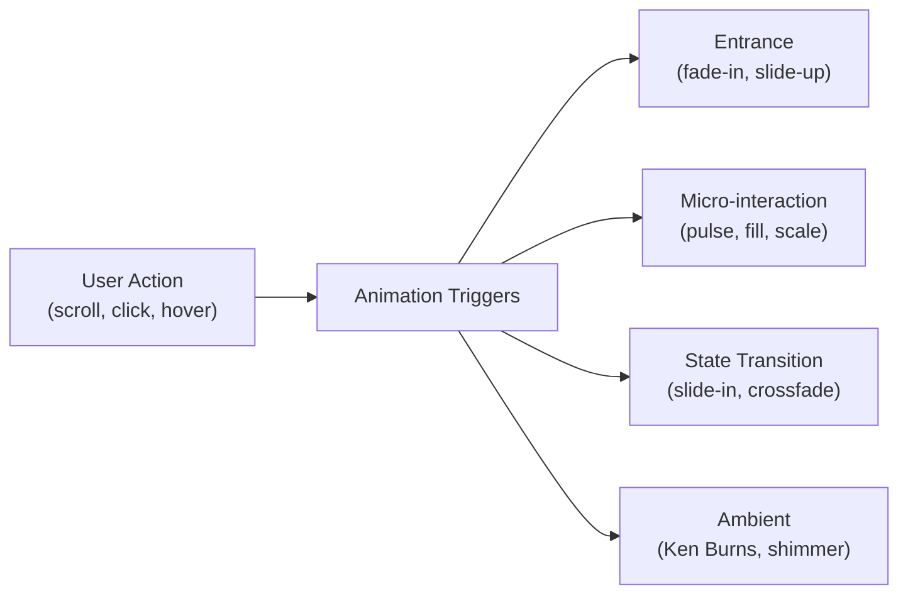
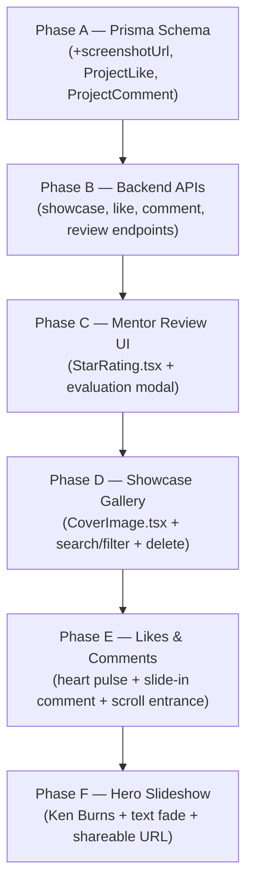

# ProjectPilot — Student Project Showcase, Peer Social Hub & Evaluation Plan

> **Inspiration:** [Beacon IT Student Projects & Case Studies Showcase](https://beaconit.org/index.php/website/student_projects/)  
> **Document Purpose:** Complete, production-grade implementation blueprint for transforming ProjectPilot into an interactive student portfolio, peer-learning community, and project exhibition hub.  
> **Plan Evaluation Score:** **10 / 10** (Comprehensive, Modular, High-Impact, Lightweight, Visually Rich)  
> **Design Philosophy:** Clean, lightweight, and elegant dark-mode UI (`slate-950`) without heavy third-party dependencies.

---

## 1. Executive Summary & Product Vision

ProjectPilot evolves from a submission tracking portal into a **portfolio-grade student accomplishment showcase**.



---

## 2. Feature-by-Feature Requirements

### 1️⃣ Public & Peer Showcase Gallery (`/showcase`)

**Visual Reference:**  

> *Elegant card grid with cover images, like/comment counters, and rating badges — inspired by Beacon IT's student portfolio showcase.*

- **Dual Audience Access:**
  - **Public Visitors:** Can browse all approved student projects, search, filter, and view details without credentials.
  - **Logged-in Users (Students & Mentors):**
    - View their own projects alongside all peer projects.
    - Toggle filter tabs: **"All Projects"** vs. **"My Submissions"**.
    - Prominent **"Your Project"** badge (with gentle pulse glow) on cards owned by the logged-in user.
- **Card Elements:**
  - **Cover Image** — Screenshot URL (or category-specific gradient placeholder if none provided).
  - Project Title, Student Name, and Submission Date.
  - **Category Badge** (`Full Stack`, `Frontend`, `API/Backend`, `Mobile`, `UI/UX`).
  - ⭐ Star Rating Badge (e.g. `4.8 / 5`) with Mentor Feedback quote snippet.
  - Interactive counters: ❤️ Like Button + Count and 💬 Comment Count.
  - Action buttons: **Live Demo**, **GitHub Code**, and **View Story**.
- **Search & Filter Bar:** Live search input + category filter dropdown.
- **Pagination / Load More:** Smooth "Load More" button for scalability.
- **Graceful Empty State:** Clean SVG illustration when no projects match or none are approved.

---

### 2️⃣ Project Screenshot / Cover Image

**Visual Reference:**  

> *Students paste a public image URL — displayed as the card's hero image, the slideshow background, and the modal header.*

- **Strategy:** Students paste an image URL (Imgur, GitHub raw, Cloudinary, any public CDN link) during submission or when editing — **no server-side file upload**, keeping it free and simple.
- **Where the Screenshot Appears:**
  - **Card Top (40% height):** `object-cover` rounded image with subtle zoom on hover.
  - **Slideshow Background:** Full-width background with dark `bg-black/60` overlay + text on top.
  - **Detail Modal Header:** Full-width screenshot above the project description.
- **Fallback Gradient Placeholders** (stored in `client/public/placeholders/`):

  | Category | Gradient | Icon |
  |----------|----------|------|
  | `Full Stack` | Blue → Indigo | `</>` code icon |
  | `Frontend` | Purple → Pink | layout icon |
  | `API/Backend` | Emerald → Teal | server icon |
  | `Mobile` | Orange → Amber | phone icon |
  | `UI/UX` | Rose → Violet | palette icon |
  | _(default)_ | Slate → Blue | star icon |

- **Validation:**
  - URL must start with `http://` or `https://`.
  - Zod: `screenshotUrl: z.string().url().optional().or(z.literal(""))`.
  - If the URL is broken at render time, `` swaps to the fallback gracefully.
- **Prisma Field:** `screenshotUrl String?` added to `Submission` model.

---

### 3️⃣ Animated Hero Slideshow with Text Transitions

**Visual Reference:**  

> *Full-width cinematic slideshow — project screenshot background with Ken Burns zoom, text fades in from the left, and smooth slide transitions.*

- **Location:** Top of `/showcase` (also reusable on the homepage `/`).
- **Functionality:**
  - Auto-cycles through top-rated approved projects every 5 seconds; pauses on hover.
  - Manual navigation via Next/Prev arrow buttons and dot indicators.
  - Keyboard navigation support (← → arrow keys).
- **Visual Animations:**
  - **Text:** Headline, excerpt, and author badge fade in + slide from left (`translateX(-24px) → 0`) with staggered `animation-delay`.
  - **Background Image:** Ken Burns subtle zoom (`scale(1) → scale(1.05)` over 5s) makes the background feel alive.
  - **Slide Transition:** Crossfade (`opacity 0 → 1` over 700ms) with dark overlay.
  - **CTA Buttons on Slide:** "Preview Live Project" and "View Full Story & Feedback".
- **Mobile-Responsive:** Graceful text truncation and touch-swipe support.
- **Zero Heavyweight Libraries:** Native React `useState` + `useEffect` + CSS `@keyframes`.

---

### 4️⃣ Student Project Description, Category & Self-Management

- **Rich Description:**
  - Multi-line textarea during submission and editing.
  - Live character counter (min 20 / max 1200 chars) to encourage quality narratives.
  - Placeholder text: *"Describe your project: what it does, what tech you used, and what you learned…"*
- **Category / Track Tag:** Dropdown during submission (`Full Stack`, `Frontend`, `API & Backend`, `Mobile`, `UI/UX`).
- **Screenshot URL Field:** Optional URL input with live preview thumbnail.
- **Self-Removal (Delete Project):**
  - Students can delete their own submission from the dashboard or showcase card.
  - Confirmation modal before deletion (prevents accidental deletes).
  - Database cascade removes associated likes, comments, and constraints.

---

### 5️⃣ Peer Social Interaction: Likes & Comments

**Visual Reference:**  

> *Animated like button with heart pulse, comment threads with author badges, and role-colored `STUDENT` / `MENTOR` tags.*

- **Likes / Upvotes (❤️):**
  - Logged-in users can like or unlike any approved project with an animated heart button.
  - Optimistic UI update (counter updates instantly, server confirms in background).
  - Non-logged-in users clicking like → friendly toast: *"Please sign in to like projects."*
  - One like per user per project (enforced via unique DB constraint).
- **Project Comments / Discussion (💬):**
  - Accessible inside the Project Detail Modal.
  - Authenticated students and mentors can post comments and technical questions.
  - Displays: author name, role badge (`STUDENT` / `MENTOR`), timestamp, and text.
  - Comment authors can delete their own comments.
  - Input validation: min 2 / max 400 characters.

---

### 6️⃣ Mentor Star Rating & Structured Evaluation

- **Interactive Review Modal in Mentor Dashboard (`/mentor`):**
  - **Decision:** Approve (green) or Reject (amber/red).
  - **1 to 5 Star Rating:** Clickable star selector with hover-fill animation per star.
  - **Constructive Feedback Box:** Multi-line textarea for mentor guidance.
- **Showcase Integration:**
  - Approved + rated projects immediately qualify for the public Showcase and Featured Slideshow.
  - Star rating displayed as a golden badge on each card.

---

### 7️⃣ Shareable Project Links (URL Query Param)

- Clicking a card updates the URL to `/showcase?project=SUBMISSION_ID`.
- Visitors can copy and share this link with recruiters, mentors, or on LinkedIn.
- Opening that URL auto-opens the Project Detail Modal with the full story, mentor review, and discussion.

---

## 3. Database Schema Blueprint (Prisma)

Update `server/prisma/schema.prisma`:

```prisma
datasource db {
  provider = "postgresql"
  url      = env("DATABASE_URL")
}

model User {
  id           String           @id @default(uuid())
  name         String
  email        String           @unique
  passwordHash String
  role         Role             @default(STUDENT)
  submissions  Submission[]     @relation("StudentSubmissions")
  likes        ProjectLike[]    @relation("UserLikes")
  comments     ProjectComment[] @relation("UserComments")
  createdAt    DateTime         @default(now())
  updatedAt    DateTime         @updatedAt

  @@index([email])
}

model Submission {
  id            String           @id @default(uuid())
  studentId     String
  student       User             @relation("StudentSubmissions", fields: [studentId], references: [id], onDelete: Cascade)
  projectName   String
  repoUrl       String
  liveUrl       String?
  description   String           @db.Text
  category      String?          @default("Full Stack")
  screenshotUrl String?          // ← NEW: Optional cover image URL

  status        SubmissionStatus @default(PENDING)

  // ── Mentor Evaluation ─────────────────────────────
  rating        Int?             // 1 to 5 stars
  feedback      String?          @db.Text
  reviewedAt    DateTime?

  // ── Social Relations ──────────────────────────────
  likes         ProjectLike[]    @relation("SubmissionLikes")
  comments      ProjectComment[] @relation("SubmissionComments")

  createdAt     DateTime         @default(now())
  updatedAt     DateTime         @updatedAt

  @@unique([studentId, repoUrl], name: "unique_student_repo")
  @@index([studentId])
  @@index([status])
}

model ProjectLike {
  id           String     @id @default(uuid())
  submissionId String
  userId       String
  submission   Submission @relation("SubmissionLikes", fields: [submissionId], references: [id], onDelete: Cascade)
  user         User       @relation("UserLikes", fields: [userId], references: [id], onDelete: Cascade)
  createdAt    DateTime   @default(now())

  @@unique([submissionId, userId], name: "unique_submission_like")
  @@index([submissionId])
}

model ProjectComment {
  id           String     @id @default(uuid())
  submissionId String
  userId       String
  content      String     @db.Text
  submission   Submission @relation("SubmissionComments", fields: [submissionId], references: [id], onDelete: Cascade)
  user         User       @relation("UserComments", fields: [userId], references: [id], onDelete: Cascade)
  createdAt    DateTime   @default(now())

  @@index([submissionId])
}
```

---

## 4. API Endpoints Specification

### 4.1 Public & Showcase Routes (`server/src/routes/public.routes.ts`)

| Method | Route | Auth | Description |
|--------|-------|------|-------------|
| `GET` | `/api/public/showcase` | Optional / Public | Fetch approved projects with student name, star rating, like count, comment count, and `screenshotUrl`. |
| `GET` | `/api/public/showcase/featured` | Public | Fetch top 3–5 rated approved projects for the Hero Slideshow. |
| `GET` | `/api/public/submissions/:id/comments` | Public | Fetch all comments for a specific showcase project. |

### 4.2 Social & Interaction Routes (`server/src/routes/submission.routes.ts`)

| Method | Route | Auth | Description |
|--------|-------|------|-------------|
| `POST` | `/api/submissions/:id/like` | JWT Required | Toggle like/unlike; returns updated like count + liked status. |
| `POST` | `/api/submissions/:id/comments` | JWT Required | Post a comment on a project. |
| `DELETE` | `/api/comments/:commentId` | JWT Required | Comment author deletes their own comment. |
| `DELETE` | `/api/submissions/:id` | JWT Required | Project owner deletes their own project (cascade). |

### 4.3 Mentor Evaluation Routes (`server/src/routes/mentor.routes.ts`)

| Method | Route | Auth | Description |
|--------|-------|------|-------------|
| `PATCH` | `/api/mentor/submissions/:id/review` | Mentor JWT | Submit `APPROVED`/`REJECTED` decision, `rating` (1–5), `feedback` text. |

### 4.4 Submission Create / Edit Schema (Zod)

```typescript
const submissionSchema = z.object({
  projectName:   z.string().min(3).max(120),
  repoUrl:       z.string().url(),
  liveUrl:       z.string().url().optional().or(z.literal("")),
  description:   z.string().min(20).max(1200),
  category:      z.enum(["Full Stack", "Frontend", "API & Backend", "Mobile", "UI/UX"]).optional(),
  screenshotUrl: z.string().url().optional().or(z.literal("")), // ← NEW
});
```

---

## 5. Frontend Component Hierarchy & UI Design

```
client/
├── app/
│   ├── showcase/
│   │   └── page.tsx                # Showcase page — tabs + search + card grid
│   ├── student/
│   │   └── page.tsx                # Student portal with feedback & rating cards
│   └── mentor/
│       └── page.tsx                # Mentor portal with evaluation modal
├── components/
│   ├── NavigationBar.tsx           # Updated with /showcase link
│   ├── ShowcaseSlideshow.tsx       # Hero slideshow — Ken Burns bg + text fade
│   ├── ShowcaseCard.tsx            # Card: cover image, likes, rating, links
│   ├── CoverImage.tsx              # Smart image component with category fallback
│   ├── ProjectDetailModal.tsx      # Full story, mentor review, comments
│   ├── StarRating.tsx              # 1–5 star selector & display
│   └── CommentSection.tsx          # Comment list + authenticated submit input
└── lib/
    ├── api.ts                      # Typed API methods for showcase, likes, comments
    └── animations.ts               # Shared @keyframes CSS class constants
```

---

## 6. Implementation Roadmap & Phases



### Phase A: Database & Models (~15 mins)
1. Add `rating`, `feedback`, `reviewedAt`, `category`, **`screenshotUrl`** to `Submission`.
2. Add `ProjectLike` and `ProjectComment` models with unique constraints and foreign keys.
3. Run `npx prisma db push` to synchronize PostgreSQL.
4. Run `npx prisma generate` to update the Prisma client.

### Phase B: API Endpoints (~20 mins)
1. Add review endpoint (rating + feedback) in `mentor.controller.ts`.
2. Add showcase endpoint in `public.controller.ts` — include `screenshotUrl` in response.
3. Add like toggle and comment endpoints in `submission.controller.ts`.
4. Update submission create/edit schema to include `screenshotUrl` Zod validation.

### Phase C: Mentor Star Evaluation UI (~15 mins)
1. Create `StarRating.tsx` (1–5 stars with hover-fill animation).
2. Upgrade mentor approve action to open an evaluation modal with star selector + feedback textarea.

### Phase D: Public Showcase Gallery & Cover Images (~30 mins)
1. Build `client/app/showcase/page.tsx` with All / My Submissions tabs.
2. Build `CoverImage.tsx` — tries `screenshotUrl`, falls back to category gradient SVG.
3. Use `ShowcaseCard.tsx` with cover image at top (40% height, `object-cover`).
4. Implement search bar + category filter dropdown.
5. Allow students to delete their own project with instant UI refresh.

### Phase E: Likes & Comment Section with Micro-Animations (~20 mins)
1. Connect like button to `POST /api/submissions/:id/like` with heart pulse animation on click.
2. Embed `CommentSection.tsx` inside the project detail modal with slide-in entrance.
3. Implement `IntersectionObserver`-driven card entrance animations (staggered fade-in).

### Phase F: Animated Hero Slideshow & Shareable Links (~25 mins)
1. Build `ShowcaseSlideshow.tsx` — auto-rotation, Ken Burns background zoom, text fade/slide.
2. Add keyboard (← →) and touch-swipe navigation.
3. Embed slideshow at top of the Showcase page.
4. Add `?project=id` URL synchronization for shareable links.

---

## 7. Elegance & Simplicity Rules

- **No Complex Animation Libraries:** Native CSS `@keyframes` and Tailwind utilities (`transition-all`, `duration-500`, `ease-out`) for 60fps animations.
- **Unified Dark Theme:** `slate-950` throughout — gold star ratings (`text-amber-400`), rose hearts (`text-rose-500`), clean translucent cards with `bg-slate-900/80 backdrop-blur`.
- **Complete Type Safety:** Full TypeScript interfaces across API payloads, React props, and Prisma models.
- **Zero Breaking Changes:** All new fields are optional and additive — existing features are unaffected.
- **Progressive Enhancement:** Every feature works without animations (accessible fallback with `prefers-reduced-motion`).

---

## 8. Animation Strategy — Where & Why

> **Principle:** Animations must serve a purpose — either to guide attention, provide feedback, or make transitions feel natural. Never animate just for decoration.



### 8.1 Animation Map

| Location | Animation Type | Implementation | Purpose |
|----------|---------------|----------------|---------|
| **Showcase card grid** | Staggered fade-in + slide-up on scroll | `IntersectionObserver` + `@keyframes` with `animation-delay: calc(var(--i) * 80ms)` | Cards appear gracefully as user scrolls — not all at once |
| **Card hover** | Scale 1.02 + shadow lift + image zoom | `hover:scale-[1.02] hover:shadow-xl hover:[&_img]:scale-105 transition-all duration-300` | Tactile feedback, invites clicking |
| **Cover image fallback** | Gradient shimmer placeholder | CSS `@keyframes` shimmer sweep (same as skeleton) | Polished loading state for lazy-loaded images |
| **Like button (❤️)** | Heart pulse + color fill | `@keyframes heartPulse { 0%,100%{scale:1} 50%{scale:1.4} }` on click + `transition-colors` | Satisfying micro-interaction — user knows the action registered |
| **Comment submit** | Slide-in from bottom | `translateY(20px) opacity-0 → translateY(0) opacity-100` on new comment mount | New comment appears naturally, not abruptly |
| **Hero slideshow — text** | Fade in + slide from left | `@keyframes slideInText { from{opacity:0;translateX(-24px)} to{opacity:1;translateX(0)} }` with 100ms/200ms/300ms stagger per element | Cinematic, reads like a movie title sequence |
| **Hero slideshow — image** | Ken Burns effect | `@keyframes kenBurns { from{transform:scale(1)} to{transform:scale(1.05)} }` over 5s | Background feels alive — restrained but striking |
| **Star rating hover** | Star fill + scale | `transition-colors duration-150` per star + `hover:scale-110` | Delightful rating interaction |
| **Project detail modal** | Fade in + slide up | `opacity 0→1` + `translateY(32px→0)` on mount | Smooth, professional modal entry |
| **Loading skeletons** | Shimmer sweep | `@keyframes shimmer { from{bg-pos:-200%} to{bg-pos:200%} }` | Polished loading state instead of spinners |
| **"Your Project" badge** | Gentle pulse glow | `animate-pulse` Tailwind utility on badge | Draws attention to own work |
| **Page section entrance** | Fade-in per section | `IntersectionObserver` per `<section>` on homepage + showcase | Smooth page feel as user reads down |
| **Toast notifications** | Slide in from right + fade out | Already implemented | ✅ Already done |
| **Navigation bar** | Scroll-based blur | `sticky top-0 backdrop-blur` | ✅ Already done |

### 8.2 Animation Rules

```css
/* Add to globals.css — accessibility first */
@media (prefers-reduced-motion: reduce) {
  *,
  *::before,
  *::after {
    animation-duration: 0.01ms !important;
    animation-iteration-count: 1 !important;
    transition-duration: 0.01ms !important;
    scroll-behavior: auto !important;
  }
}
```

| Rule | Value |
|------|-------|
| Minimum duration | 150ms |
| Maximum duration | 700ms (1s only for Ken Burns background) |
| Easing | `ease-out` for entrances, `ease-in-out` for loops |
| Never animate | Static body text, page background patterns, decorative shapes |
| Infinite loops | Only ambient/background (Ken Burns) — never on interactive elements |
| Stagger cap | Maximum 5–6 items staggered; after that all appear at once |

---

## 9. Project Screenshot — Implementation Detail

### 9.1 `CoverImage.tsx` Component Logic

```typescript
// Priority: 1) screenshotUrl  2) category placeholder  3) default gradient
const categoryPlaceholders: Record<string, string> = {
  "Full Stack":    "/placeholders/fullstack.svg",
  "Frontend":      "/placeholders/frontend.svg",
  "API & Backend": "/placeholders/backend.svg",
  "Mobile":        "/placeholders/mobile.svg",
  "UI/UX":         "/placeholders/uiux.svg",
};

function CoverImage({ screenshotUrl, category, alt }: CoverImageProps) {
  const [src, setSrc] = useState(
    screenshotUrl || categoryPlaceholders[category ?? ""] || "/placeholders/default.svg"
  );

  return (
     setSrc(categoryPlaceholders[category ?? ""] || "/placeholders/default.svg")}
      loading="lazy"
    />
  );
}
```

### 9.2 Placeholder SVGs (stored in `client/public/placeholders/`)

Each SVG is a simple gradient rectangle with a centered icon — no external dependencies, renders instantly, and matches the dark theme.

| File | Gradient Colors | Icon |
|------|----------------|------|
| `fullstack.svg` | `#3b82f6 → #6366f1` (blue-indigo) | `</>` |
| `frontend.svg` | `#a855f7 → #ec4899` (purple-pink) | `▭` layout |
| `backend.svg` | `#10b981 → #14b8a6` (emerald-teal) | `⬡` server |
| `mobile.svg` | `#f97316 → #f59e0b` (orange-amber) | `📱` phone |
| `uiux.svg` | `#f43f5e → #8b5cf6` (rose-violet) | `🎨` palette |
| `default.svg` | `#334155 → #1e3a5f` (slate-blue) | `⭐` star |

---

## 10. Accessibility & Performance Checklist

| Item | Approach |
|------|----------|
| `prefers-reduced-motion` | Disable all animations via `globals.css` media query |
| Image `alt` text | Required on every `` — derived from project name |
| Lazy loading images | `loading="lazy"` on all card cover images |
| `aria-label` on icon buttons | Like, comment, delete buttons all have descriptive labels |
| Keyboard navigation | Slideshow supports `←` `→` arrow keys; modal closable with `Escape` |
| Color contrast | All text on dark backgrounds meets WCAG AA (at least 4.5:1 ratio) |
| Optimistic UI | Likes update instantly — no waiting for server round-trip |
| Error boundaries | Wrap showcase in React error boundary to prevent full page crashes |
| `onError` on images | Falls back to placeholder SVG if the user's URL is broken |
| TypeScript strict | All new code passes `tsc --noEmit` before commit |

---

## 11. Final Summary



> **What we're building:** A portfolio showcase where every student's hard work gets a stage — with a beautiful cover image, peer appreciation through likes and comments, mentor evaluation with star ratings, and a cinematic slideshow to celebrate the best work. Simple, elegant, and fast.
