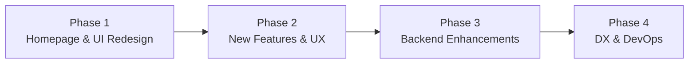

# ProjectPilot — Post-Assessment Enhancement Plan

> **Status:** Job task complete ✅. This document outlines the full roadmap for redesigning, optimizing, and extending the application into a polished portfolio-grade project.

---

## 🗺️ Overview

The current app covers the minimum viable scope of the hiring task. This plan evolves it into a **fully-featured, production-polished platform** across four upgrade phases. Each phase is independent and can be implemented in any order.



---

## Phase 1 — Homepage & UI Redesign

> **Goal:** Transform the current static landing page into a compelling, conversion-focused homepage that showcases the platform professionally.

### 1.1 Homepage Sections to Add

| Section | Description |
|---------|-------------|
| **Hero** | Animated headline, subtext, and two CTA buttons (Student Sign Up / Mentor Login). Typewriter effect on the tagline. |
| **How It Works** | 3-step horizontal flow: Register → Submit Project → Get Reviewed. Use icons + step numbers. |
| **Features Grid** | 6 feature cards with icons: Submission Portal, Mentor Review Dashboard, Role-Based Access, URL Validation, Pagination & Filters, Real-Time Stats. |
| **Stats Counter** | Animated counters: *X Projects Submitted*, *X Approved*, *X Students*. Fetches live data from `/api/public/stats` endpoint. |
| **Testimonials / Social Proof** | Static or seed-driven quotes from "students" (can be dummy data for now). |
| **Tech Stack Showcase** | Logo strip: Next.js, Express, PostgreSQL, Prisma, TypeScript, Tailwind, JWT. |
| **FAQ Accordion** | Collapsible Q&A about the platform (How to sign up? How are projects reviewed? etc.). |
| **Footer** | Links to GitHub repo, tech stack, copyright. |

### 1.2 Visual & UX Improvements

- Replace plain background image with a **CSS animated mesh gradient** or **particle canvas** (zero external dependency).
- Add **scroll animations** using CSS `@keyframes` or the lightweight `IntersectionObserver` API (no Framer Motion needed).
- Improve **color palette consistency** — dark mode primary: `slate-950`, accent: `indigo-500`, success: `emerald-500`, danger: `rose-500`.
- Add a **sticky responsive navbar** with smooth active-link highlighting and a mobile hamburger menu.
- Replace raw text badges with **polished shadcn `<Badge>` components** across all pages.

### 1.3 New shadcn/ui Components to Install

```bash
npx shadcn@latest add badge dialog tooltip skeleton progress separator accordion tabs avatar
```

---

## Phase 2 — New Frontend Features & UX

> **Goal:** Give both Students and Mentors richer, more useful interfaces.

### 2.1 Student Dashboard Improvements

| Feature | Implementation Notes |
|---------|---------------------|
| **Edit Submission** | Allow editing `projectName`, `liveUrl`, `description` on PENDING submissions only. `PATCH /api/submissions/:id`. |
| **Delete Submission** | Student can delete their own PENDING submission. `DELETE /api/submissions/:id`. |
| **Submission Detail Page** | Dedicated route `/student/submissions/[id]` showing full detail, mentor feedback comment, and status history. |
| **Submission Status Timeline** | Visual stepper: `Submitted → Under Review → Approved/Rejected`. |
| **Empty State Improvement** | Animated illustration (SVG) when no submissions yet, with a CTA to submit. |
| **Toast Notifications** | Replace `alert()` with a `sonner` or `react-hot-toast` toast for all actions. |

### 2.2 Mentor Dashboard Improvements

| Feature | Implementation Notes |
|---------|---------------------|
| **Feedback / Comment on Review** | Mentor can leave a text comment when Approving or Rejecting. Stored in a new `reviewNote` field on `Submission`. |
| **Student Profile View** | Click a student's name to see their full profile and all their submissions in a drawer/modal. |
| **Bulk Actions** | Checkbox column to select multiple PENDING submissions and approve/reject in one action. |
| **Sorting Controls** | Sort submissions by date, project name, or student name (server-side ORDER BY). |
| **Dashboard Charts** | Simple bar/pie chart showing submission distribution using `recharts` (lightweight, React-first). |
| **Search Bar** | Debounced search by project name or student email via query param. |
| **Export to CSV** | Button to download filtered submissions as a `.csv` file (client-side generation). |

### 2.3 Shared UX Improvements

| Feature | Description |
|---------|-------------|
| **Dark/Light Mode Toggle** | Add `next-themes` for system/manual theme switching. Tailwind `dark:` classes throughout. |
| **Loading Skeletons** | Replace raw spinners with shadcn `<Skeleton>` shimmer cards for all data-loading states. |
| **Responsive Tables** | Mobile-friendly card view on small screens, table view on desktop. |
| **Global Error Boundary** | Proper `error.tsx` and `not-found.tsx` pages with helpful navigation. |
| **Account Settings Page** | `/settings` page to update display name and change password. |

---

## Phase 3 — Backend Enhancements

> **Goal:** Extend the API, harden security, and improve performance and observability.

### 3.1 New API Endpoints

| Method | Route | Description |
|--------|-------|-------------|
| `PATCH` | `/api/submissions/:id` | Student edits own PENDING submission |
| `DELETE` | `/api/submissions/:id` | Student deletes own PENDING submission |
| `GET` | `/api/submissions/:id` | Get single submission detail (student or mentor) |
| `GET` | `/api/public/stats` | Public aggregate stats for homepage counter |
| `PATCH` | `/api/users/me` | Update own profile (name, password) |
| `GET` | `/api/admin/users` | *(Future)* Admin-only user list |

### 3.2 Prisma Schema Additions

```prisma
model Submission {
  // ... existing fields ...
  reviewNote  String?          // Mentor feedback comment
  reviewedAt  DateTime?        // Timestamp of review action
  techStack   String[]         // e.g. ["React", "Node.js", "MongoDB"]
  tags        Tag[]            @relation("SubmissionTags")
}

model Tag {
  id          String       @id @default(uuid())
  name        String       @unique
  submissions Submission[] @relation("SubmissionTags")
}
```

### 3.3 Security & Performance Improvements

| Item | Action |
|------|--------|
| **Refresh Tokens** | Add a `RefreshToken` model and `/api/auth/refresh` endpoint. Reduces JWT expiry to 15m access + 7d refresh. |
| **HttpOnly Cookies** | Migrate token storage from `localStorage` to `HttpOnly` + `SameSite=Strict` cookies. Eliminates XSS token theft. |
| **Helmet.js** | Add `helmet` middleware for secure HTTP headers (CSP, HSTS, etc.). |
| **Request Logging** | Add `morgan` middleware for structured request logs. |
| **Input Sanitization** | Add `dompurify` or server-side stripping of HTML from text fields. |
| **Pagination Cursor** | Migrate from offset-based to cursor-based pagination for performance on large tables. |
| **Database Connection Pooling** | Configure Prisma `connection_limit` and `pool_timeout` for Neon serverless. |
| **Health Check Improvement** | Extend `/health` to also check database reachability and return response time. |

### 3.4 Email Notifications *(Nice to Have)*

| Trigger | Action |
|---------|--------|
| Student registers | Welcome email via Resend or SendGrid |
| Submission approved | "Congratulations" email to student |
| Submission rejected | Rejection email with mentor feedback |

---

## Phase 4 — Developer Experience & DevOps

> **Goal:** Make the project easier to run locally, safer to deploy, and easier to contribute to.

### 4.1 Development Improvements

| Item | Description |
|------|-------------|
| **`concurrently`** | Replace manual `npm run dev:server` + `npm run dev:client` with one `npm run dev` from root. |
| **ESLint + Prettier** | Shared ESLint config and Prettier with pre-commit hooks via `husky` + `lint-staged`. |
| **Path Aliases** | Cleaner imports like `@server/services/prisma` using tsconfig `paths`. |
| **Docker Compose** | Local `docker-compose.yml` to spin up PostgreSQL + server without needing a Neon account. |
| **API Client Generator** | Use `openapi-ts` or `zod-openapi` to auto-generate typed API client from routes. |

### 4.2 Testing Improvements

| Item | Description |
|------|-------------|
| **Playwright E2E Tests** | Browser-level tests: sign up → submit → mentor review full flow. |
| **Coverage Report** | Add `--coverage` to Jest and enforce minimum thresholds (80%). |
| **CI/CD via GitHub Actions** | On every push to `main`: run lint + type-check + Jest + build. Block merge on failure. |
| **Seed Factories** | Replace hardcoded test data in tests with `@faker-js/faker` factory functions. |

### 4.3 Deployment Improvements

| Item | Description |
|------|-------------|
| **Preview Deployments** | Vercel preview URLs per PR. Set backend env to staging Neon branch. |
| **Neon Branching** | Use Neon's database branching per environment (prod / staging / test). |
| **Render Auto-Deploy** | Configure Render deploy hooks triggered by GitHub Actions only after tests pass. |
| **Monitoring** | Add Sentry (free tier) for both Next.js and Express to capture runtime exceptions. |

---

## 📅 Suggested Implementation Order

| Week | Focus | Outcome |
|------|-------|---------|
| **Week 1** | Phase 1 (Homepage redesign, new sections, shadcn components) | Polished, impressive landing page |
| **Week 2** | Phase 2 Student (Edit/Delete, toast, timeline, skeletons) | Complete student workflow |
| **Week 3** | Phase 2 Mentor (Feedback, search, charts, bulk actions) | Power-user mentor dashboard |
| **Week 4** | Phase 3 Backend (New endpoints, schema additions, Helmet, logging) | Hardened, fully-featured API |
| **Week 5** | Phase 4 DX (CI/CD, Docker, Playwright, coverage) | Production-grade developer workflow |

---

## 🏁 Definition of "Done" for Each Phase

A phase is complete when:
1. All new features pass automated tests.
2. TypeScript compiles with zero errors (`npm run build`).
3. Both frontend and backend deploy without errors.
4. The README is updated to document any new setup steps or env vars.
5. Changes are committed to `main` and pushed to GitHub.
